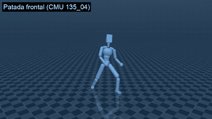
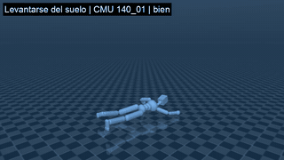
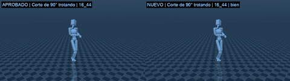
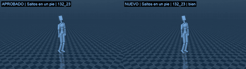

# training-humanoid-football

Un humanoide simulado que aprende a moverse como una persona y después a jugar al fútbol. Nada de lo que hace
es una animación grabada: cada paso, salto o patada sale de la física, de los torques que su "cerebro"
(una red neuronal) aplica en cada articulación. Si se equivoca, se cae.

La meta final es un **minijuego de fútbol en Unreal Engine 5** con jugadores que se mueven de forma realista.
Se avanza por etapas, sin saltarse ninguna:

1. **Moverse como un humano, de forma natural:** estar de pie, caminar, girar, trotar, correr, saltar, caer y levantarse.
2. **Movimiento atlético para el fútbol, sin balón:** esprintar, cortes de 90°, cambios de ritmo y el gesto de la patada.
3. **El balón:** física del balón validada, controlar, conducir, pasar y tirar.
4. **Unreal:** llevar los jugadores entrenados al juego.

**Cómo vamos:** 12 de 37 habilidades dominadas (de imitarlas con éxito y de forma natural), todas de las etapas 1 y 2.
El detalle está en el [checklist de habilidades](docs/checklist_habilidades.md), que se actualiza solo con cada corrida.

## Avance en clips

**22 nov 2026: primer día.** El tracker preentrenado de NVIDIA, sin ajustar todavía, imita movimientos humanos
de la base de mocap de CMU en el simulador MuJoCo: patada, saltos en un pie y un corte de 90° corriendo.



**22 nov 2026: primera medición del checklist.** Levantarse del suelo boca abajo, una de las habilidades que ya hacía desde el inicio.



**24 nov 2026: primer modelo aprobado tras entrenar en GPU.** Cada corrida se compara lado a lado con el modelo
anterior (izquierda) antes de aprobarla. Corte de 90° trotando y saltos en un pie:




Los clips de cada corrida (todas las habilidades) están en la rama [`media`](../../tree/media/runs).

## Cómo funciona

- **Cuerpo y punto de partida:** [ProtoMotions](https://github.com/NVlabs/ProtoMotions) de NVIDIA con el cuerpo Anatomical SOMA
  y su tracker preentrenado, que imita cualquier movimiento humano que se le muestre.
- **Clips de referencia:** [CMU Motion Capture](http://mocap.cs.cmu.edu) (uso libre), convertidos al cuerpo SOMA con un retargeter propio.
- **Entrenamiento:** ajuste fino con PPO en una GPU spot de AWS (Isaac Lab), una corrida al día, con tope de gasto de $50/mes.
  La GPU solo entrena; la medición y los videos se hacen gratis en GitHub Actions con MuJoCo.
- **Revisión humana:** cada corrida abre un PR con sus clips y métricas. Se mide si lo hace (100% de éxito en 5 intentos
  y error < 10 cm) y si se ve natural (nota visual). Un modelo que empeora algo se rechaza solo; si mejora y se aprueba,
  el merge lo promueve y la siguiente corrida parte de él.
- **Juego (más adelante):** MuJoCo embebido en Unreal para la física del jugador y del balón; las políticas corren como ONNX.

Plan completo: [docs/plan.md](docs/plan.md) · Bitácora de experimentos: [journal/experiments.md](journal/experiments.md) ·
Licencias: [docs/licensing.md](docs/licensing.md) · Instrucciones del agente: [CLAUDE.md](CLAUDE.md)

## Primeros pasos (Mac)
```bash
brew install gitleaks
make hooks
make login
make check-account
```

## Seguridad
Sin claves de larga duración: SSO en local, OIDC en GitHub Actions, instance profiles en EC2.
Los datos de mocap y los modelos con licencia nunca se suben al repo (ver [docs/licensing.md](docs/licensing.md)).
