# Corrida 2026-11-22-base: Tracker NVIDIA preentrenado, sin ajuste (punto de partida)

- **Costo de la corrida:** $0 (medido en el Mac)
- **Lo hace (100% de éxito, error < 10 cm):** 9 habilidades medidas en MuJoCo, 5 corridas por clip.
- **Compilación de todos los clips:** [compilacion.mp4](https://github.com/brando93/training-humanoid-football/blob/media/runs/2026-11-22-base/compilacion.mp4?raw=true).
- **Qué cambió:** Primera revisión: punto de partida antes de entrenar. Datos CMU retargeteados, sin ajuste fino.

Los clips son física real en MuJoCo: el humanoide se mueve solo con sus motores, imitando el mocap.

## Etapa 1 — Moverse como un humano, de forma natural

| Habilidad | Clip | Lo hace | Éxito · error | Fallas |
|---|---|---|---|---|
| Estar de pie quieto, relajado | — | ⬜ | sin clips todavía | |
| **Equilibrio en un pie** | 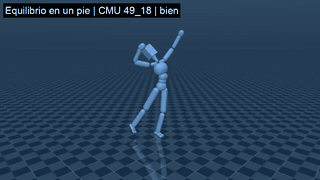<br>bien | 🟡 | 100% · 10.7 cm |  |
| Agacharse y volver a erguirse | — | ⬜ | sin clips todavía | |
| Caminar hacia adelante | — | ⬜ | sin clips todavía | |
| **Caminar hacia atrás** | 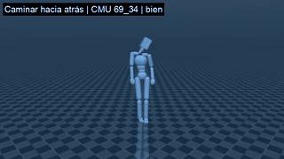<br>bien | ✅ | 100% · 6.8 cm |  |
| **Pasos laterales** | 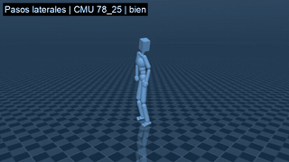<br>bien | ✅ | 100% · 10.0 cm |  |
| Girar en el sitio | — | ⬜ | sin clips todavía | |
| Caminar cambiando de dirección | — | ⬜ | sin clips todavía | |
| Trotar | — | ⬜ | sin clips todavía | |
| **Correr** | 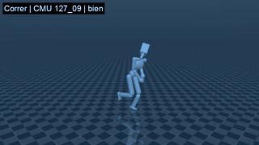<br>bien<br>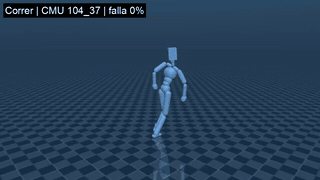<br>falla 0% | 🟡 | 33% · 11.1 cm | 104_37 (0/5), 104_48 (0/5) |
| **Arrancar desde quieto** | 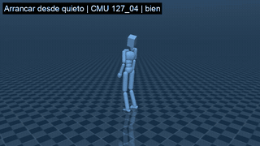<br>bien | ✅ | 100% · 6.0 cm |  |
| **Frenar hasta quedar quieto** | 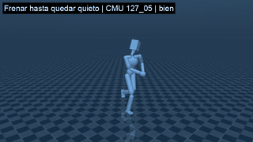<br>bien | ✅ | 100% · 7.6 cm |  |
| **Saltar con los dos pies** | 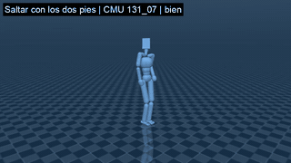<br>bien<br>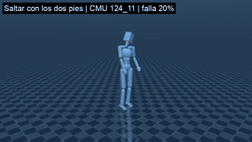<br>falla 20% | 🟡 | 73% · 10.3 cm | 124_11 (1/5) |
| **Levantarse del suelo** | 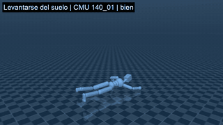<br>bien<br>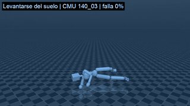<br>falla 0% | 🟡 | 75% · 9.5 cm | 140_03 (0/5) |
| Caer sin dañarse y recuperarse | — | ⬜ | sin clips todavía | |

## Etapa 2 — Movimiento atlético para el fútbol (sin balón)

| Habilidad | Clip | Lo hace | Éxito · error | Fallas |
|---|---|---|---|---|
| Esprintar | — | ⬜ | sin clips todavía | |
| **Pasar de trote a carrera** | 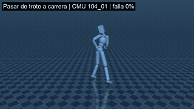<br>falla 0% | ❌ | 0% · — | 104_01 (0/5) |
| **Correr, parar y volver a correr** | 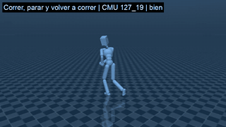<br>bien<br>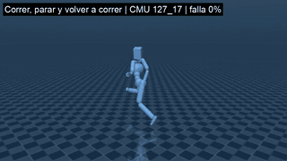<br>falla 0% | 🟡 | 50% · 8.8 cm | 127_17 (0/5) |
| **Corte de 90° trotando** | 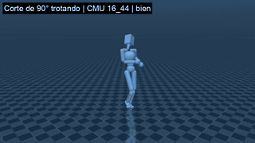<br>bien | ✅ | 100% · 9.4 cm |  |
| **Corte de 90° corriendo** | 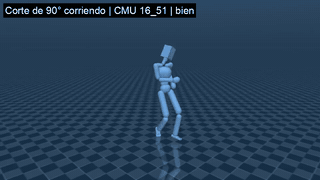<br>bien | 🟡 | 100% · 10.8 cm |  |
| **Giro corriendo** | 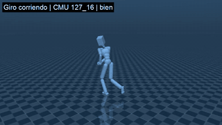<br>bien | ✅ | 100% · 8.2 cm |  |
| **Desplazamiento lateral rápido** | 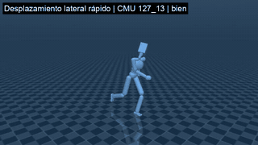<br>bien | ✅ | 100% · 9.8 cm |  |
| **Salto con carrera** | 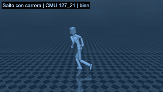<br>bien | 🟡 | 100% · 10.5 cm |  |
| **Saltos en un pie** | 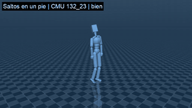<br>bien | ✅ | 100% · 8.0 cm |  |
| Saltar para cabecear | — | ⬜ | sin clips todavía | |
| **Gesto de patada de fútbol (sin balón)** | 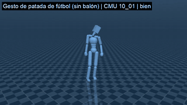<br>bien | ✅ | 100% · 7.3 cm |  |

## Tu review

Copia este bloque en tu review (botón **Review changes**), pon una nota a cada habilidad y comenta lo que se vea mal.
- **5:** indistinguible de una persona · **4:** natural con detalles menores · **3:** se nota artificial
  · **2:** robótico o raro · **1:** antinatural. Deja vacío lo que no quieras calificar.
- Al enviar el review, en ~1 min un commit del bot guarda tus notas en el PR y recalcula el checklist.
- Luego: **merge** = este modelo pasa a ser el oficial. **Cerrar sin merge** = se descarta.

```yaml
naturalidad:
  un_pie: 
  caminar_atras: 
  caminar_lateral: 
  correr: 
  arrancar: 
  frenar: 
  saltar_dos_pies: 
  levantarse: 
  trote_a_carrera: 
  correr_parar_correr: 
  corte_90_trote: 
  corte_90_carrera: 
  giro_corriendo: 
  lateral_corriendo: 
  salto_con_carrera: 
  saltos_un_pie: 
  gesto_patada: 
comentarios: |
  
```
