# Corrida 2026-11-23-0546: Fase 3b: ajuste fino del tracker con clips CMU

- **Costo de la corrida:** ≈ $1,10 (g6.2xlarge spot, ~90 min)
- **Lo hace (100% de éxito, error < 10 cm):** 0 habilidades medidas en MuJoCo, 5 corridas por clip.
- **Compilación de todos los clips:** [compilacion.mp4](https://github.com/brando93/training-humanoid-football/blob/media/runs/2026-11-23-0546/compilacion.mp4?raw=true).
- **Qué cambió:** Parte de: nvidia (comparado con la corrida 2026-11-22-base). Entrenó 35 min (pasos acumulados: 5898240).
- **Ganó "lo hace":** ninguna
- **⚠️ Perdió "lo hace":** arrancar, corte_90_trote, frenar_en_seco, giro_corriendo, hacia_atras, lateral_corriendo, lateral_defensivo, patear_balon_futbol, saltos_un_pie

Los clips son física real en MuJoCo: el humanoide se mueve solo con sus motores, imitando el mocap.

## Etapa 1 — Moverse como un humano, de forma natural

| Habilidad | Clip | Lo hace | Éxito · error | Fallas |
|---|---|---|---|---|
| Estar de pie quieto, relajado | — | ⬜ | sin clips todavía | |
| **Equilibrio en un pie** | 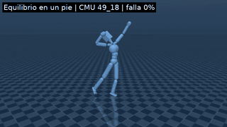<br>falla 0% | ❌ | 0% · — | 49_18 (0/5), 49_19 (0/5), 49_20 (0/5) |
| Agacharse y volver a erguirse | — | ⬜ | sin clips todavía | |
| Caminar hacia adelante | — | ⬜ | sin clips todavía | |
| **Caminar hacia atrás** | 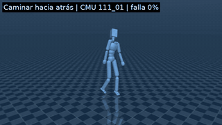<br>falla 0% | ❌ | 0% · — | 111_01 (0/5), 69_34 (0/5), 76_11 (0/5) |
| **Pasos laterales** | 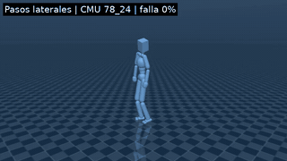<br>falla 0% | ❌ | 0% · — | 78_24 (0/5), 78_25 (0/5), 78_26 (0/5), 78_27 (0/5) |
| Girar en el sitio | — | ⬜ | sin clips todavía | |
| Caminar cambiando de dirección | — | ⬜ | sin clips todavía | |
| Trotar | — | ⬜ | sin clips todavía | |
| **Correr** | 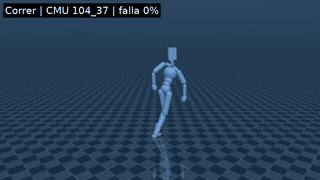<br>falla 0% | ❌ | 0% · — | 104_37 (0/5), 104_48 (0/5), 127_09 (0/5) |
| **Arrancar desde quieto** | 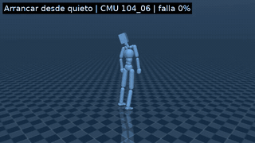<br>falla 0% | ❌ | 0% · — | 104_06 (0/5), 104_08 (0/5), 127_04 (0/5) |
| **Frenar hasta quedar quieto** | 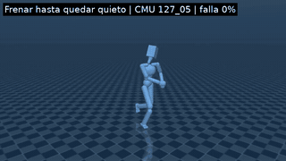<br>falla 0% | ❌ | 0% · — | 127_05 (0/5), 128_05 (0/5), 16_08 (0/5), 16_57 (0/5) |
| **Saltar con los dos pies** | 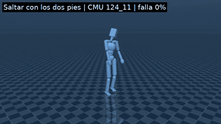<br>falla 0% | ❌ | 0% · — | 124_11 (0/5), 131_07 (0/5), 143_06 (0/5) |
| **Levantarse del suelo** | 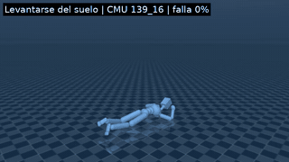<br>falla 0% | ❌ | 0% · — | 139_16 (0/5), 139_17 (0/5), 140_01 (0/5), 140_03 (0/5) |
| Caer sin dañarse y recuperarse | — | ⬜ | sin clips todavía | |

## Etapa 2 — Movimiento atlético para el fútbol (sin balón)

| Habilidad | Clip | Lo hace | Éxito · error | Fallas |
|---|---|---|---|---|
| Esprintar | — | ⬜ | sin clips todavía | |
| **Pasar de trote a carrera** | 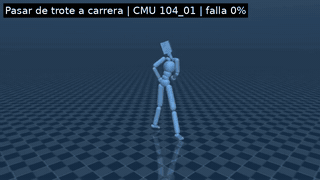<br>falla 0% | ❌ | 0% · — | 104_01 (0/5), 127_04 (0/5) |
| **Correr, parar y volver a correr** | 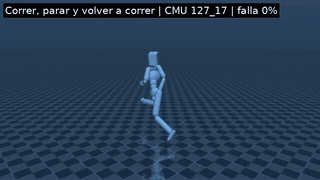<br>falla 0% | ❌ | 0% · — | 127_17 (0/5), 127_19 (0/5) |
| **Corte de 90° trotando** | 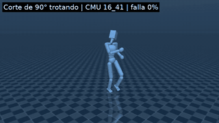<br>falla 0% | ❌ | 0% · — | 16_41 (0/5), 16_42 (0/5), 16_43 (0/5), 16_44 (0/5) |
| **Corte de 90° corriendo** | 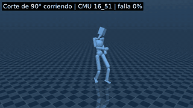<br>falla 0% | ❌ | 0% · — | 16_51 (0/5), 16_52 (0/5), 16_53 (0/5), 16_54 (0/5) |
| **Giro corriendo** | 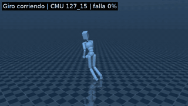<br>falla 0% | ❌ | 0% · — | 127_15 (0/5), 127_16 (0/5) |
| **Desplazamiento lateral rápido** | 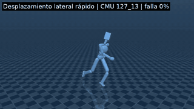<br>falla 0% | ❌ | 0% · — | 127_13 (0/5), 127_14 (0/5) |
| **Salto con carrera** | 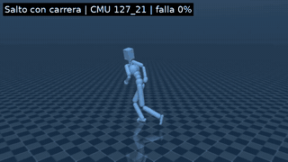<br>falla 0% | ❌ | 0% · — | 127_21 (0/5), 49_04 (0/5) |
| **Saltos en un pie** | 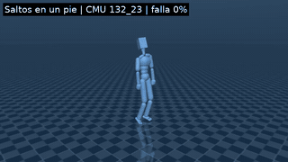<br>falla 0% | ❌ | 0% · — | 132_23 (0/5), 132_24 (0/5) |
| Saltar para cabecear | — | ⬜ | sin clips todavía | |
| **Gesto de patada de fútbol (sin balón)** | 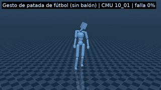<br>falla 0% | ❌ | 0% · — | 10_01 (0/5), 10_02 (0/5), 10_03 (0/5), 10_05 (0/5), 10_06 (0/5), 11_01 (0/5) |

## Tu review

Copia este bloque en tu review (botón **Review changes**), pon una nota a cada habilidad y comenta lo que se vea mal.
- **5:** indistinguible de una persona · **4:** natural con detalles menores · **3:** se nota artificial
  · **2:** robótico o raro · **1:** antinatural. Deja vacío lo que no quieras calificar.
- Al enviar el review, en ~1 min un commit del bot guarda tus notas en el PR y recalcula el checklist.
- Luego: **merge** = este modelo pasa a ser el oficial. **Cerrar sin merge** = se descarta.

```yaml
naturalidad:
  un_pie: 
  caminar_atras: 
  caminar_lateral: 
  correr: 
  arrancar: 
  frenar: 
  saltar_dos_pies: 
  levantarse: 
  trote_a_carrera: 
  correr_parar_correr: 
  corte_90_trote: 
  corte_90_carrera: 
  giro_corriendo: 
  lateral_corriendo: 
  salto_con_carrera: 
  saltos_un_pie: 
  gesto_patada: 
comentarios: |
  
```
