# Corrida 2026-11-24-0250: Fase 3b: ajuste fino del tracker con clips CMU

- **Costo de la corrida:** ≈ $1,29 (g6.2xlarge spot, 87 min; medición y clips rescatados en la Mac)
- **Lo hace (100% de éxito, error < 10 cm):** 12 habilidades medidas en MuJoCo, 5 corridas por clip.
- **Compilación de todos los clips:** [compilacion.mp4](https://github.com/brando93/training-humanoid-football/blob/media/runs/2026-11-24-0250/compilacion.mp4?raw=true).
- **Qué cambió:** Parte de: tracker NVIDIA (comparado con 2026-11-22-base). Entrenó 35 min; mejor punto en la época 60.
- **Ganó "lo hace":** dos_pies, levantarse, un_pie
- **⚠️ Perdió "lo hace":** ninguna
- **Evaluación interna durante el entrenamiento (éxito):** 0.906 → 0.906 → 0.906 → 0.924 → 0.924. Se usa el mejor punto (0.925). Parada: None.

Los clips son física real en MuJoCo: el humanoide se mueve solo con sus motores, imitando el mocap. **Izquierda: modelo aprobado · derecha: modelo nuevo.**

## Etapa 1 — Moverse como un humano, de forma natural

| Habilidad | Clip | Lo hace | Éxito · error | Fallas |
|---|---|---|---|---|
| Estar de pie quieto, relajado | — | ⬜ | sin clips todavía | |
| **Equilibrio en un pie** | 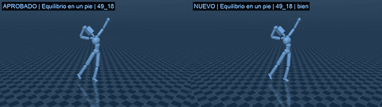<br>bien | ✅ | 100% · 7.9 cm |  |
| Agacharse y volver a erguirse | — | ⬜ | sin clips todavía | |
| Caminar hacia adelante | — | ⬜ | sin clips todavía | |
| **Caminar hacia atrás** | 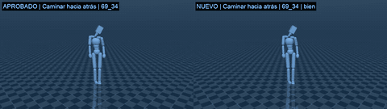<br>bien | ✅ | 100% · 6.6 cm |  |
| **Pasos laterales** | 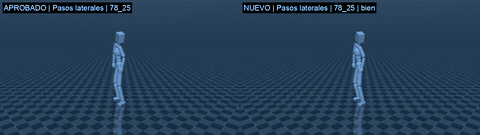<br>bien | ✅ | 100% · 8.7 cm |  |
| Girar en el sitio | — | ⬜ | sin clips todavía | |
| Caminar cambiando de dirección | — | ⬜ | sin clips todavía | |
| Trotar | — | ⬜ | sin clips todavía | |
| **Correr** | 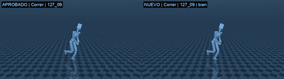<br>bien<br>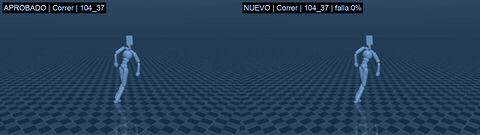<br>falla 0% | 🟡 | 33% · 10.8 cm | 104_37 (0/5), 104_48 (0/5) |
| **Arrancar desde quieto** | 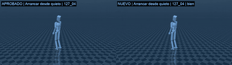<br>bien | ✅ | 100% · 6.0 cm |  |
| **Frenar hasta quedar quieto** | 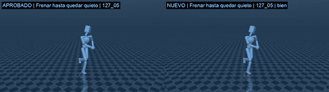<br>bien | ✅ | 100% · 7.6 cm |  |
| **Saltar con los dos pies** | <br>bien | ✅ | 100% · 9.7 cm |  |
| **Levantarse del suelo** | 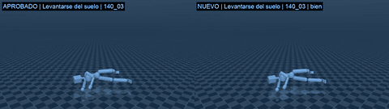<br>bien | ✅ | 100% · 9.8 cm |  |
| Caer sin dañarse y recuperarse | — | ⬜ | sin clips todavía | |

## Etapa 2 — Movimiento atlético para el fútbol (sin balón)

| Habilidad | Clip | Lo hace | Éxito · error | Fallas |
|---|---|---|---|---|
| Esprintar | — | ⬜ | sin clips todavía | |
| **Pasar de trote a carrera** | 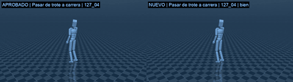<br>bien<br>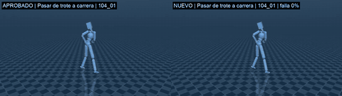<br>falla 0% | 🟡 | 50% · 4.7 cm | 104_01 (0/5) |
| **Correr, parar y volver a correr** | 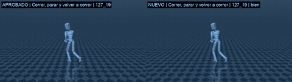<br>bien<br>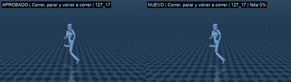<br>falla 0% | 🟡 | 50% · 8.5 cm | 127_17 (0/5) |
| **Corte de 90° trotando** | 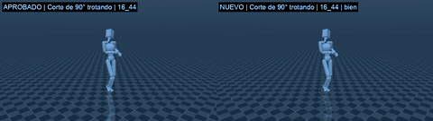<br>bien | ✅ | 100% · 9.1 cm |  |
| **Corte de 90° corriendo** | 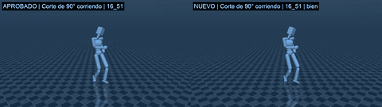<br>bien | 🟡 | 100% · 10.4 cm |  |
| **Giro corriendo** | 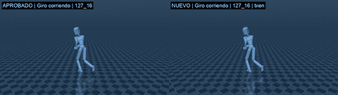<br>bien | ✅ | 100% · 8.2 cm |  |
| **Desplazamiento lateral rápido** | 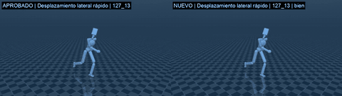<br>bien | ✅ | 100% · 8.0 cm |  |
| **Salto con carrera** | 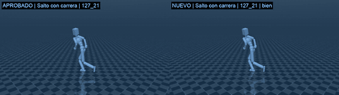<br>bien | 🟡 | 100% · 10.0 cm |  |
| **Saltos en un pie** | 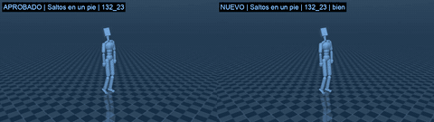<br>bien | ✅ | 100% · 7.8 cm |  |
| Saltar para cabecear | — | ⬜ | sin clips todavía | |
| **Gesto de patada de fútbol (sin balón)** | 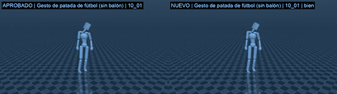<br>bien | ✅ | 100% · 6.7 cm |  |

## Tu review

Copia este bloque en tu review (botón **Review changes**). Por habilidad: `nota` 1–5, `vs_anterior`
(mejor / igual / peor que la izquierda) y `defectos`. Deja vacío lo que no quieras calificar.
- **Nota:** 5 indistinguible de una persona · 4 natural con detalles menores · 3 se nota artificial ·
  2 robótico o raro · 1 antinatural (≥ 4 = natural).
- **Defectos:** `patina`, `rigido`, `brusco`, `se_cae`, `final_inestable`, `postura_rara`, `brazos_raros`,
  `falla`, `otro`. Cada uno dispara un ajuste concreto: ver [guía de review](../../../docs/review_guide.md).
- Al enviar el review, en ~1 min un commit del bot guarda tus notas en el PR y recalcula el checklist.
- Luego: **merge** = este modelo pasa a ser el oficial. **Cerrar sin merge** = se descarta.

```yaml
naturalidad:
  un_pie: {nota: , vs_anterior: , defectos: []}
  caminar_atras: {nota: , vs_anterior: , defectos: []}
  caminar_lateral: {nota: , vs_anterior: , defectos: []}
  correr: {nota: , vs_anterior: , defectos: []}
  arrancar: {nota: , vs_anterior: , defectos: []}
  frenar: {nota: , vs_anterior: , defectos: []}
  saltar_dos_pies: {nota: , vs_anterior: , defectos: []}
  levantarse: {nota: , vs_anterior: , defectos: []}
  trote_a_carrera: {nota: , vs_anterior: , defectos: []}
  correr_parar_correr: {nota: , vs_anterior: , defectos: []}
  corte_90_trote: {nota: , vs_anterior: , defectos: []}
  corte_90_carrera: {nota: , vs_anterior: , defectos: []}
  giro_corriendo: {nota: , vs_anterior: , defectos: []}
  lateral_corriendo: {nota: , vs_anterior: , defectos: []}
  salto_con_carrera: {nota: , vs_anterior: , defectos: []}
  saltos_un_pie: {nota: , vs_anterior: , defectos: []}
  gesto_patada: {nota: , vs_anterior: , defectos: []}
comentarios: |
  
```
